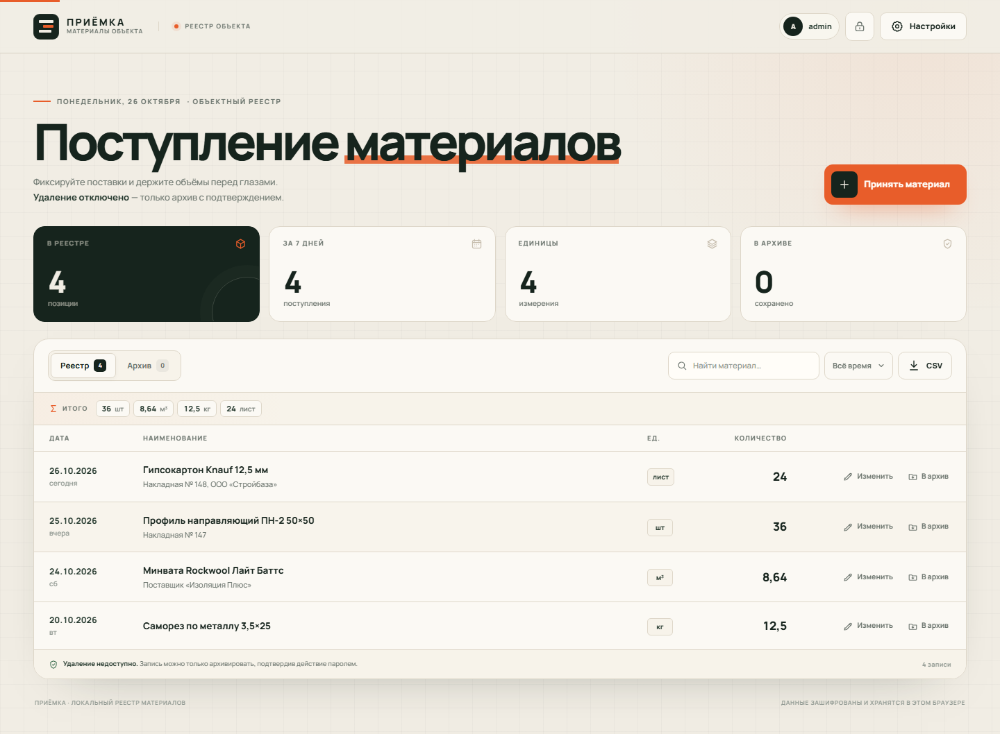

# ПРИЁМКА

Локальный реестр материалов, поступающих на объект. Дата, наименование, единица измерения и количество — без таблиц, лишних полей и случайных удалений.

**Живая версия:** https://ervsed.github.io/priemka-materialov/



## Возможности

- **Быстрая регистрация.** Дата подставляется автоматически, единицы измерения выбираются в один клик.
- **Редактирование с историей.** У каждой записи хранится до 40 последних действий. После сохранения изменение можно сразу отменить одной кнопкой.
- **Без безвозвратного удаления.** В приложении физически нет функции удаления записи. Можно только переместить её в архив, подтвердив действие текущим паролем. Из архива запись возвращается в реестр.
- **Вход по логину и паролю.** Пароль не передаётся на сервер: на его основе в браузере создаётся ключ шифрования.
- **Шифрование AES-256-GCM.** Реестр хранится в `localStorage` только в зашифрованном виде. Параметры PBKDF2-SHA-256: 310 000 итераций, случайная соль.
- **Блокировка.** После 30 минут бездействия сессия закрывается, ключ удаляется из памяти. Вход выполняется заново.
- **Резервная копия.** Зашифрованный JSON-файл можно восстановить на чистом устройстве.
- **Экспорт в CSV.** Выгрузка текущей выборки для Excel; разделитель — точка с запятой, кодировка UTF-8 с BOM.
- **Поиск, период, итоги по единицам.** Суммы не смешиваются между разными единицами измерения.
- **Адаптивный интерфейс и офлайн-режим.** PWA-оболочка кэшируется service worker-ом.

## Как начать

1. Откройте [живую версию](https://ervsed.github.io/priemka-materialov/) в современном браузере.
2. При первом запуске придумайте логин и пароль (минимум 8 символов). Это локальный аккаунт конкретного браузера.
3. Нажмите **«Принять материал»** и заполните дату, наименование, единицу и количество.
4. Сразу сделайте резервную копию: **Настройки → Скачать копию**. Файл зашифрован, но для восстановления понадобится пароль.

### Защита от удаления

- Кнопки «Удалить» нет ни в интерфейсе, ни в коде приложения.
- Архивация требует повторного ввода текущего пароля.
- В архиве данные остаются на месте; запись можно вернуть.
- Все изменения фиксируются в истории; последнее изменение можно отменить.
- Восстановление резервной копии поверх существующего реестра заблокировано: импорт доступен только при первом запуске на чистом устройстве.

## Где хранятся данные

Это **полностью клиентское приложение**. GitHub Pages отдаёт только статические файлы: ни пароль, ни материалы на сервер не отправляются.

- Реестр и параметры аккаунта хранятся в `localStorage` текущего браузера в зашифрованном виде.
- На время активной вкладки ключ находится в памяти страницы и в `sessionStorage`, чтобы страница переживала перезагрузку. При закрытии вкладки или блокировке ключ удаляется.
- Записи **не синхронизируются между устройствами автоматически**. Для переноса используйте резервную копию.
- Очистка данных сайта в браузере удалит локальный реестр. Без резервной копии восстановить его невозможно.
- Если пароль забыт, расшифровать данные нельзя. Резервную копию можно открыть на чистом устройстве старым паролем.

### Важные ограничения

Вход по паролю и шифрование защищают данные от случайного доступа на общем устройстве и от утечки через сервер (сервера нет). Они не заменяют защиту операционной системы и браузера: злоумышленник с полным доступом к разблокированному профилю браузера или вредоносным расширением может получить доступ к данным. Для работы с особо чувствительными данными нужен полноценный сервер с аутентификацией и разграничением прав.

## Запуск локально

Сайту нужен HTTP(S)-контекст для Web Crypto и service worker:

```powershell
python -m http.server 8080
```

Затем откройте `http://localhost:8080/`.

## Публикация на GitHub Pages

Репозиторий публикуется из ветки `main`, корневой папки. В настройках репозитория:

**Settings → Pages → Build and deployment → Deploy from a branch → `main` / `/ (root)`**

Файл `.nojekyll` уже добавлен, чтобы GitHub Pages не обрабатывал статику через Jekyll.

## Структура

```text
.
├── index.html            # интерфейс и SVG-иконки
├── styles.css            # дизайн-система и адаптивность
├── app.js                # шифрование, аккаунт, реестр, архив, экспорт
├── sw.js                 # офлайн-оболочка
├── manifest.webmanifest  # PWA-манифест
├── assets/               # иконки приложения
├── fonts/                # self-hosted Manrope + лицензия OFL
├── docs/                 # скриншоты для README
└── .nojekyll
```

## Технологии

Чистый HTML, CSS и JavaScript без сборщика и внешних зависимостей. Web Crypto API, localStorage/sessionStorage, service worker. Шрифт Manrope распространяется по SIL Open Font License.

## Лицензия

MIT. См. [LICENSE](LICENSE).
