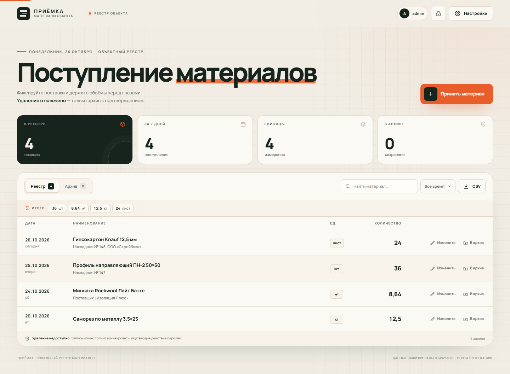

# ПРИЁМКА

Реестр материалов, поступающих на объект. Дата, наименование, единица измерения и количество — без лишней бюрократии, случайных удалений и потерянных строк. Одна и та же ведомость доступна на нескольких устройствах.

**Живая версия:** https://ervsed.github.io/priemka-materialov/
**Почтовый сервис:** [mailer/README.md](mailer/README.md) — необязательный backend для писем по расписанию.



## Возможности

- **Быстрая регистрация.** Дата подставляется автоматически, единицы измерения выбираются в один клик.
- **Редактирование с историей.** У каждой записи хранится до 40 последних действий. После сохранения изменение можно сразу отменить одной кнопкой.
- **Без безвозвратного удаления.** В приложении нет функции удаления записи. Можно только переместить её в архив, подтвердив действие текущим паролем. Из архива запись возвращается в реестр.
- **Вход по логину и паролю.** Пароль не передаётся на сервер: на его основе в браузере создаётся ключ шифрования.
- **Шифрование AES-256-GCM.** Реестр хранится в `localStorage` только в зашифрованном виде. PBKDF2-SHA-256: 310 000 итераций, случайная соль.
- **Общая ведомость.** Несколько устройств работают с одной базой на вашем сервере. Есть резервный режим через зашифрованный GitHub Gist. Записи объединяются, а не заменяют друг друга.
- **Блокировка.** После 30 минут бездействия сессия закрывается, ключ удаляется из памяти.
- **Резервные копии и CSV.** Зашифрованная копия восстанавливается на чистом устройстве; текущая выборка выгружается в Excel.
- **Почта по расписанию.** Настраиваемый email, ежедневная / еженедельная / ежемесячная частота, время и часовой пояс, данные за сегодня / 7 / 30 дней / всё время. В письме — HTML-отчёт, CSV и зашифрованная копия реестра.
- **Поиск, период, итоги по единицам.** Суммы не смешиваются между разными единицами измерения.
- **Адаптивность и офлайн-доступ.** PWA-оболочка кэшируется service worker-ом.

## Быстрый старт

1. Откройте [живую версию](https://ervsed.github.io/priemka-materialov/).
2. При первом запуске создайте логин и пароль (минимум 8 символов).
3. Нажмите **«Принять материал»** и заполните дату, наименование, единицу и количество.
4. Сразу скачайте резервную копию: **Настройки → Скачать копию**.

Пароль невозможно восстановить: он не хранится на сервере. Без резервной копии данные нельзя вернуть после очистки браузера.

## Общая ведомость на двух устройствах

Это исправляет ситуацию, когда на телефоне и компьютере получались две разные ведомости. Подключение **не заменяет** локальную базу: записи с обоих устройств объединяются, существующие данные сохраняются.

Основной режим — **единая база на вашем сервере** (папка [`server/`](server/), Python + SQLite). Отдельный GitHub-аккаунт для него не нужен.

1. Откройте **Настройки → Общая ведомость → Настроить**.
2. Вставьте **код сервера**, выданный владельцем базы, и нажмите **«Подключиться к серверу»**.
3. Повторите это на втором устройстве с тем же кодом.
4. Оба устройства увидят объединённый реестр. Дальше изменения синхронизируются автоматически при сохранении, при возврате на вкладку и каждые 20 секунд.

Если сервер ещё не развёрнут, остаётся резервный вариант **GitHub Gist**: на первом устройстве нужен токен с правом `gist`, после создания ведомости появится код для второго устройства. В этом режиме данные перед отправкой шифруются на устройстве.

Особенности:

- Локальные аккаунты и пароли на устройствах могут быть разными.
- Записи сопоставляются по постоянному ID. Разные записи с двух устройств просто добавляются в общий список.
- Если одну запись изменили на двух устройствах, применяется более свежее изменение, а история версий объединяется.
- Архивные записи тоже синхронизируются. Удаления нет.
- Код сервера — секрет: он открывает доступ к общей базе. Не передавайте его посторонним.
- Отключение синхронизации не удаляет ни локальные записи, ни данные на сервере. Повторное подключение возможно по тому же коду.

### Где хранится общая ведомость

**Основной режим:** записи лежат в SQLite-базе на вашем сервере (`/opt/priemka/data/priemka.db`). Сайт обменивается с ней данными по HTTPS. Доступ к API защищён длинным кодом; CORS разрешён только для домена приложения. Сервер ежедневно делает сжатые резервные копии.

Локальный реестр на каждом устройстве по-прежнему хранится в зашифрованном виде. На сервере данные хранятся в базе SQLite в открытом виде — доступ к серверу и файлу базы должен быть ограничен. Это не end-to-end-шифрование, а общая база под вашим контролем.

**Резервный режим GitHub Gist:** данные шифруются на устройстве ключом AES-256-GCM, GitHub видит только шифротекст. Токен хранится в зашифрованном локальном реестре и не попадает в Gist.

Ограничения: у Gist есть лимит размера, у GitHub API — лимит запросов, у серверной базы — лимит в 5 МБ на один обмен. При превышении приложение покажет ошибку, локальные данные останутся на месте.

## Почта по расписанию

GitHub Pages раздаёт только статический сайт и не может сам отправлять письма. Для почты добавлен небольшой backend в папке [`mailer/`](mailer/), который разворачивается отдельно.

1. Разверните [`mailer/`](mailer/) по [инструкции](mailer/README.md), задайте SMTP-сервер, отправителя и секретный `MAIL_API_TOKEN`.
2. В приложении откройте **Настройки → Почта и отчёты → Настроить**.
3. Укажите email получателя, частоту, время и период данных.
4. Вставьте HTTPS-адрес сервиса и `MAIL_API_TOKEN`.
5. Сохраните настройки и отправьте тестовое письмо.

Письмо содержит HTML-отчёт, CSV для Excel и зашифрованную `.json`-копию реестра. SMTP-пароль хранится только на сервере. Подробности — в [mailer/README.md](mailer/README.md).

## Защита от удаления

- Кнопки «Удалить» нет ни в интерфейсе, ни в коде приложения.
- Архивация требует повторного ввода текущего пароля.
- В архиве данные остаются на месте; запись можно вернуть.
- Все изменения фиксируются в истории; последнее изменение можно отменить.
- Синхронизация только добавляет и объединяет записи, никогда не очищает удалённое.
- Восстановление резервной копии поверх существующего реестра заблокировано: импорт доступен только при первом запуске на чистом устройстве.

## Где хранятся данные

- Реестр и настройки хранятся в `localStorage` текущего браузера в зашифрованном виде.
- На время активной вкладки ключ находится в памяти и в `sessionStorage`, чтобы страница переживала перезагрузку. При закрытии вкладки или блокировке ключ удаляется.
- Без общей ведомости данные остаются только на устройстве. Для переноса используйте резервную копию.
- При подключённой общей ведомости данные хранятся в общей базе на вашем сервере, а устройства обмениваются изменениями автоматически. В резервном режиме Gist хранится зашифрованный снимок.
- При включённой автоматической почте снимок реестра отправляется на ваш почтовый сервис. Отключение отправки очищает снимок и архив на сервере.
- Очистка данных сайта в браузере удаляет локальный реестр. Без резервной копии восстановить его невозможно.
- Если пароль забыт, расшифровать локальные данные нельзя. Резервную копию можно открыть на чистом устройстве старым паролем.

### Ограничения безопасности

Вход по паролю и шифрование защищают данные от случайного доступа на общем устройстве и от утечки через статический хостинг. Они не заменяют защиту операционной системы: злоумышленник с полным доступом к разблокированному профилю браузера или вредоносным расширением может получить доступ к данным.

Токен GitHub и код сервера — это секреты. Не передавайте их в открытых каналах. Код сервера даёт доступ к общей базе; соединение защищено HTTPS, но база хранится на сервере в открытом виде и должна быть защищена доступом к серверу. Секретный Gist не является приватным хранилищем с авторизацией на чтение: любой, кто узнал прямую ссылку и код, сможет расшифровать данные. Шифрование защищает от GitHub и случайной утечки ссылки, но не от получателя кода.

## Локальный запуск

Сайту нужен HTTP(S)-контекст для Web Crypto и service worker:

```powershell
python -m http.server 8080
```

Откройте `http://localhost:8080/`.

## Тесты

Фронтенд проверялся в Chromium: вход, добавление, редактирование и отмена, архивация с паролем, восстановление, смена пароля, резервные копии, CSV, офлайн-режим, почтовые настройки, а также **слияние двух независимых локальных баз через общую базу на сервере**.

Сервер общей базы:

```bash
python3 server/test_sync.py
```

Backend почты:

```bash
cd mailer
npm ci
npm test
npm run test:integration
```

## Публикация на GitHub Pages

Публикация идёт из ветки `main`, корневой папки. В настройках репозитория:

**Settings → Pages → Build and deployment → Deploy from a branch → `main` / `/ (root)`**

Файл `.nojekyll` уже добавлен.

## Структура

```text
.
├── index.html              # интерфейс и SVG-иконки
├── styles.css              # дизайн-система и адаптивность
├── app.js                  # шифрование, реестр, архив, общая база, почта
├── sw.js                   # офлайн-оболочка
├── manifest.webmanifest    # PWA-манифест
├── assets/                 # иконки приложения
├── fonts/                  # self-hosted Manrope + лицензия OFL
├── docs/                   # скриншоты
├── server/                 # общая база: Python + SQLite, systemd, Nginx
│   ├── priemka_sync.py
│   ├── test_sync.py
│   ├── backup.py
│   ├── priemka-sync.service
│   ├── nginx-priemka-api.conf
│   └── priemka-rate.conf
├── mailer/                 # необязательный SMTP-backend и планировщик
│   ├── server.mjs
│   ├── mailer.mjs
│   ├── schedule.mjs
│   ├── report.mjs
│   ├── state-store.mjs
│   ├── Dockerfile
│   └── test/
└── .nojekyll
```

## Технологии

Чистый HTML, CSS и JavaScript без сборщика. Web Crypto API, localStorage/sessionStorage, service worker. Общая база: Python 3 без внешних зависимостей, SQLite, systemd, Nginx. Резервный режим: GitHub Gist API. Необязательный backend почты: Node.js 20, SMTP через Nodemailer, планировщик с IANA-часовыми поясами, шифрование состояния на диске. Шрифт Manrope — SIL Open Font License.

## Лицензия

MIT. См. [LICENSE](LICENSE).
